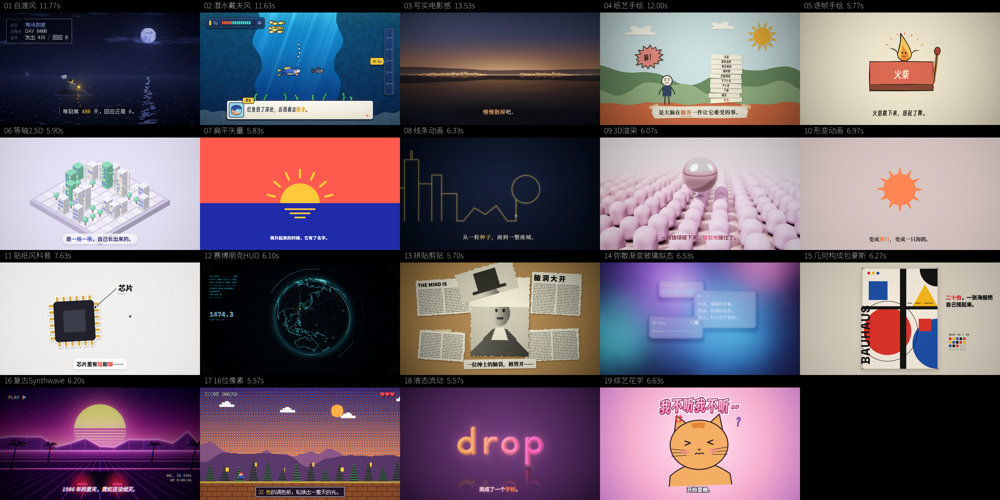

# 创意短片 · 风格版

一个可以直接运行的创意短片 skill。给它主题、文字或想法，它会选择视觉母题、写字幕、设计镜头，再生成原创动画。随附 Remotion 工程可直接运行；新片也可以按需求选择三维或混合制作，见 [工具选择](references/工具选择.md)。也可以传入参考视频，拆解风格、制作原创试片，验证后保存为可复用的风格。

默认输出 **1920×1080 / 30fps / 3 分钟以内**，字幕叙事，只有音效。用户可以指定时长、尺寸或声音要求。



| # | 风格 | 画面与故事 | 文档 |
|---|---|---|---|
| 01 | 自渡风 | 暗夜像素、提灯角色、HUD；困境与自救 | [说明](references/风格_01_自渡风.md) |
| 02 | 潜水戴夫风 | 明亮海底、像素角色；任务与知识图鉴 | [说明](references/风格_02_潜水戴夫风.md) |
| 03 | 写实电影感 | 着色器光影、发光母题；情绪与哲思 | [说明](references/风格_03_写实电影感.md) |
| 04 | 纸艺手绘 | 纸纹、剪边、定格运动；生活比喻 | [说明](references/风格_04_纸艺手绘.md) |
| 05 | 逐帧手绘 | 抖动墨线、跳帧；手作与角色表演 | [说明](references/风格_05_逐帧手绘.md) |
| 06 | 等轴2.5D | 等轴投影与色块；空间、城市与系统 | [说明](references/风格_06_等轴2.5D.md) |
| 07 | 扁平矢量 | 干净色块与弹性运动；产品与轻科普 | [说明](references/风格_07_扁平矢量.md) |
| 08 | 线条动画 | 描线与发光轮廓；路径与概念呈现 | [说明](references/风格_08_线条动画.md) |
| 09 | 3D渲染 | 胶囊、铬球、软光；产品与柔软质感 | [说明](references/风格_09_3D渲染.md) |
| 10 | 形变动画 | 轮廓连续变形；概念连接与转场 | [说明](references/风格_10_形变动画.md) |
| 11 | 贴纸风科普 | 白边贴纸与弹入卡片；知识与反差 | [说明](references/风格_11_贴纸风科普.md) |
| 12 | 赛博朋克HUD | 扫描、地图与数据面板；科技与监测 | [说明](references/风格_12_赛博朋克HUD.md) |
| 13 | 拼贴剪贴 | 剪贴、网点、旧纸；观点与视觉隐喻 | [说明](references/风格_13_拼贴剪贴.md) |
| 14 | 弥散渐变玻璃拟态 | 极光渐变与折射卡片；数字产品 | [说明](references/风格_14_弥散渐变玻璃拟态.md) |
| 15 | 几何构成包豪斯 | 几何、原色与印刷颗粒；设计与秩序 | [说明](references/风格_15_几何构成包豪斯.md) |
| 16 | 复古Synthwave | 霓虹网格、落日与扫描线；复古科技 | [说明](references/风格_16_复古Synthwave.md) |
| 17 | 16位像素 | 彩色像素、角色与关卡；冒险与游戏 | [说明](references/风格_17_16位像素.md) |
| 18 | 液态流动 | 融球、拉丝与字标；流动与品牌开场 | [说明](references/风格_18_液态流动.md) |
| 19 | 综艺花字 | 夸张字形、贴纸与冲击；情绪与笑点 | [说明](references/风格_19_综艺花字.md) |

19 套风格均保留组件和示例入口，完整路径见 [风格库](references/风格库.md)。前四个示例带声音编排；新增 15 个示例只演示画面，文档里的声音章节是制作建议。

海底风格借鉴《潜水员戴夫》的视觉语言，随附角色与界面由代码绘制，不包含游戏原始素材。

## 参考视频学习模式

用户传一段视频，skill 会按这条流程处理：

1. 抽帧、记录时间码、查看连续运动，按需要提取音轨。
2. 拆解构图、色光、材质、字幕、运动、转场和声音，区分观察与实现推测。
3. 做约 10–20 秒原创试片，对照参考修正关键差异。
4. 用户要求沉淀时，将验证过的方法保存成风格文档、组件/工程和原创示例，登记到 [风格库](references/风格库.md)。

可以直接这样说：

```text
用 $innovation-styles 学习我上传的视频风格，命名为“暖色墨线”。先拆解，再做一段 15 秒原创试片，验证后沉淀到风格库。新片仍然只有音效。
```

下次调用：

```text
用 $innovation-styles 的“暖色墨线”风格，做一条 30 秒关于拖延的短片。
```

这是将经验保存为文件和可复用工程，不涉及训练模型。只要求模仿做片时，分析保留在该项目；明确要求学习/沉淀时完成入库。原视频、抽帧和音轨默认保存在本地 `studies/`，不随 Git 提交。当前尚未登记用户参考视频的新风格。

本地视频的采样入口：

```bash
python3 scripts/study_video.py '/绝对路径/参考视频.mp4' --name amber-ink --start 0 --end 20 --frames 12 --audio
```

分析区间需在视频时长内，也可省略 `--start/--end` 采样整段。脚本负责准备证据，风格分析和原创实现由使用 skill 的 AI 完成。完整规则见 [参考视频学习与沉淀](references/参考视频学习.md)。

## 安装 skill

Codex：

```bash
git clone https://github.com/guminghao-avi/innovation-styles.git ~/.codex/skills/innovation-styles
```

Claude Code：

```bash
git clone https://github.com/guminghao-avi/innovation-styles.git ~/.claude/skills/innovation-styles
```

如果目标目录已存在，先检查已有内容再选择位置。也可下载仓库 ZIP，将完整文件夹命名为 `innovation-styles`，放到相应工具的 skill 目录；代码、字体和参考文档都要一起保留。

调用示例：

```text
用 $innovation-styles 做一条 20 秒纸艺手绘短片，主题是“为什么计划越多越不想开始”。字幕叙事，只有音效，直接交付 MP4。
```

## 运行示例

需要 **Node.js 22.18+（推荐 24）、Python 3.10+、FFmpeg 与 ffprobe**。下面命令在仓库根目录执行：

```bash
npm ci
python3 -m venv .venv
.venv/bin/python -m pip install -r requirements.txt
npm run check
npm test
npm run studio
```

Studio 默认打开纸艺示例。所有 19 套的现成示例都用 Remotion；下面的运行命令适用于这些示例。渲染代表静帧：

```bash
node scripts/render.mjs --proj '示例_纸艺手绘' --stills 1.5,11
```

生成纸艺示例声音并导出 MP4：

```bash
.venv/bin/python projects/示例_纸艺手绘/gen_sound.py
.venv/bin/python scripts/sound.py 示例_纸艺手绘
node scripts/render.mjs --proj '示例_纸艺手绘' --video
```

新增画面示例可直接渲染，未生成 `audio/mix.wav` 时输出不含音轨：

```bash
node scripts/render.mjs --proj '示例_液态流动' --stills 1,5
node scripts/render.mjs --proj '示例_液态流动' --video
```

用户要求有音效的成片时，需要另行编排声音并验收，不能将无音轨的画面示例当作已经完成。

Windows 将 `.venv/bin/python` 换成 `.venv\Scripts\python.exe`。Remotion 首次渲染会下载 Chrome Headless Shell；默认使用软件 WebGL。机器较慢时先跑静帧或 1–3 秒测试片，再决定渲染块长和并发数。

## 包含什么

- [SKILL.md](SKILL.md)：选风格、创作、视觉检查和成片交付的入口。
- [工具选择](references/工具选择.md)：按画面需求选择 Remotion、三维或混合路线，区分现成实现与需要另做的工程。
- [制作与验收](references/制作与验收.md)：Remotion 时间轴、声音、缓存、续渲与最终 MP4 验收。
- [参考视频学习](references/参考视频学习.md) 与 [风格库](references/风格库.md)：视频拆解、原创试片、风格沉淀及后续调用。
- `src/kit/`：时间、Canvas、GLSL、镜头、字幕和字体工具。
- `src/styles/`：19 套视觉风格的绘画与 UI 组件。
- `projects/示例_*/`：19 部示例短片的源码；前四个另含声音编排。
- `projects/参考_*/`：两部历史长片源码，用于学习镜头和结构。

仓库不包含本地虚拟环境、依赖目录、音频、成片和渲染缓存；示例成片可按上面的命令生成。静帧按批次保留，画面输入变化会生成新缓存目录；修改声音或调色时可以只重新合成。详细流程见制作与验收文档。

随附字体的作者与许可见 [字体许可](fonts/LICENSES.md)。HUD 地图组件注明采用 Natural Earth 1:110m 数据，其 [使用条款](https://www.naturalearthdata.com/about/terms-of-use/)为公共领域；源码附带 `land110.json`。配音功能仅在明确要求时调用联网的 Edge TTS 服务，台词会发送到该服务。其余默认字幕、画面与音效合成在本地完成。

## 验证记录

2026-10-14，在 macOS Apple Silicon、Node.js 24.15.0、Python 3.13 环境验证：六个自带项目类型检查通过，七项运行逻辑回归检查通过，四种风格各渲出代表静帧并查看；2 秒编码测试通过，短音频补静音后仍为 1920×1080、30fps、60 帧，完整解码成功。当时的四风格预览来自实渲（当前总览已更新为 19 套）。未对四部示例重新全片编码，未测试 Windows/Linux 或联网 TTS。

同日新增参考视频学习模式：用本地纸艺视频验证了采样总览与音轨输出，并用合成测试视频验证取帧、指定区间、原尺寸、无音轨、无效输入与批次保留；当前 `npm test` 共 11 项通过。尚未用用户新参考视频完整跑过风格提炼、原创试片与入库流程。

同日合入新版 19 套风格：21 个自带项目（19 个示例、2 个历史参考）类型检查通过，12 项回归检查通过；每套渲染并查看开头、中段和尾部静帧，共 57 张，当前总览取自本次中段实渲。新增示例中 14 个 `post.json` 的小数写法已修成有效 JSON；19 个文档、组件和示例入口及 Markdown 相对链接检查通过。此前学习采样、字体加载、时间轴、画面缓存和短音频补静音修复保留。

3D 示例的 1.8–4.0 秒区间与液态示例的 0.5–3.5 秒区间分别输出为 66 帧、90 帧的 1920×1080 / 30fps MP4，完整解码与成片抽帧检查通过，均无音轨。本次没有重新编码 19 部完整示例，也未执行 Blender/真实流体路线；后者是工具选择与工程保存规则，需按具体项目另行实现和验证。
